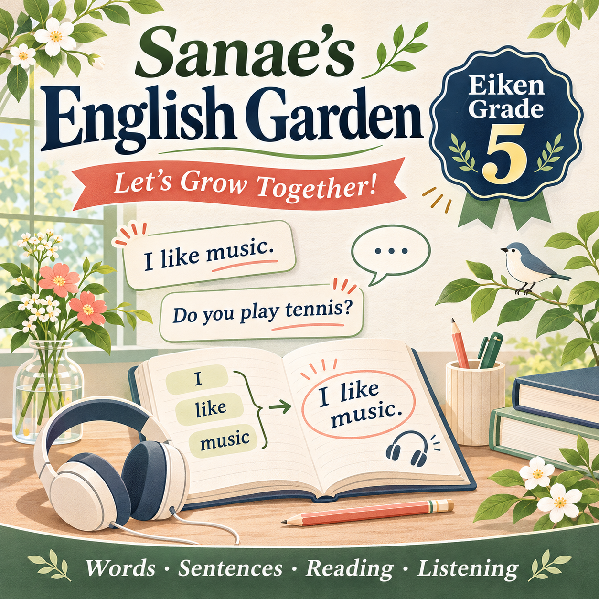

# 🌱 Sanae’s English Garden — Let’s Grow Together!
# さなえ先生のえいごガーデン ～いっしょに育とう！～
# Eiken Grade 5 · 英検５級

Build your English confidence with Sanae! We’ll explore useful words and expressions, discover how sentences fit together, and practise understanding everyday English through reading, listening, and conversation. With clear explanations and engaging activities about school, family, hobbies, and daily life, we’ll develop a strong foundation and prepare for Eiken Grade 5—one step at a time.

さなえ先生といっしょに、英語の自信を育てましょう！身近な単語や表現を学び、語順や文のしくみを理解しながら、読む・聞く・話す練習に取り組みます。学校・家族・趣味・毎日の生活をテーマに、わかりやすい説明と楽しいアクティビティを通して英語の基礎を身につけ、一歩ずつ英検５級を目指します。

